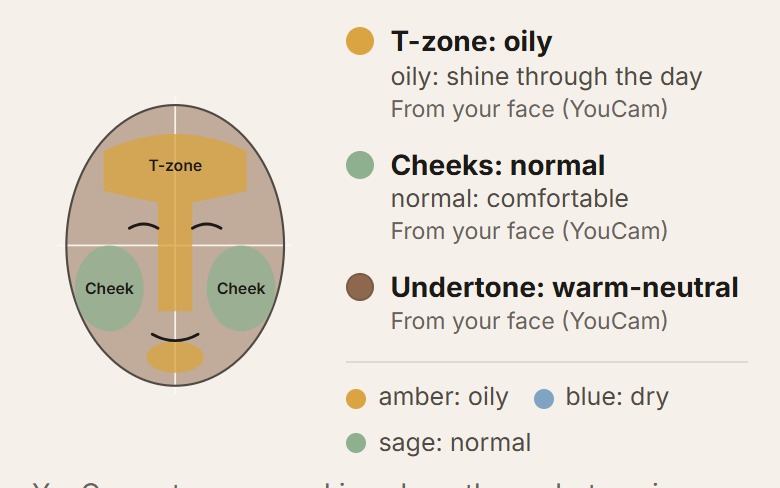
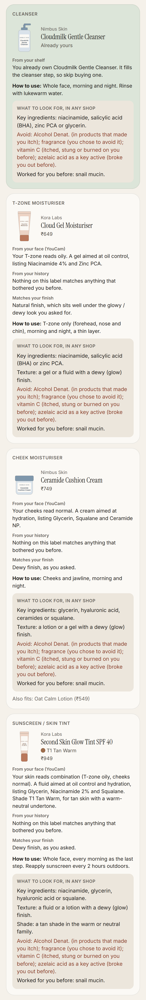
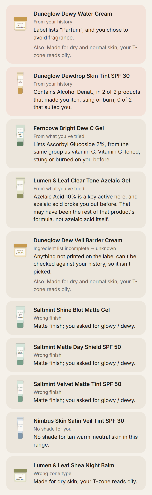
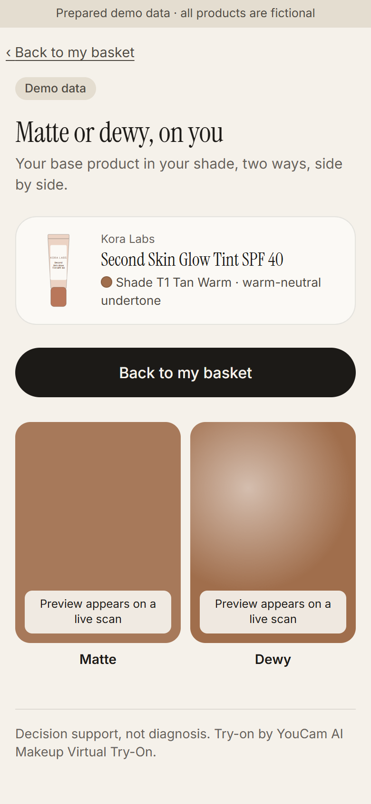
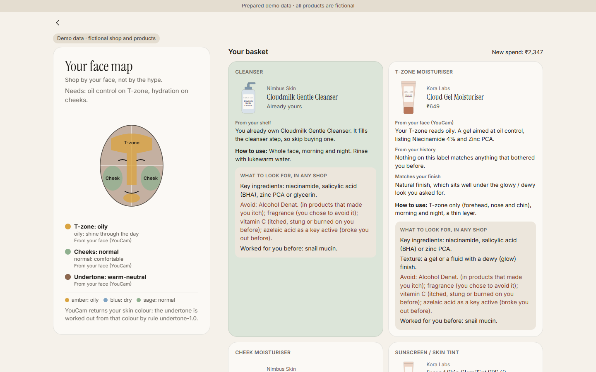
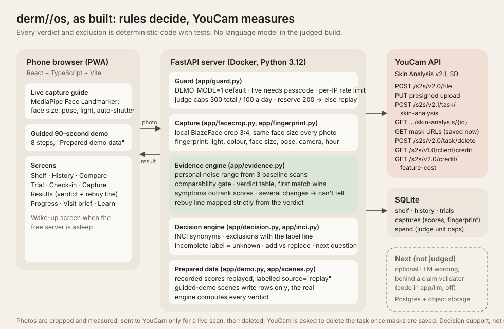

# derm//os

[](https://github.com/aarushitandon0/derm-os/actions/workflows/ci.yml)

**Shop by your face, not by the hype.** One selfie becomes a skincare basket from the store's own stock: measured zone by zone with YouCam, matched to the finish you want, in your undertone, minus everything that has bothered you before. Then you see the finish on your own face before you pay.

Opened skincare usually can't be returned. On sale day people buy what's trending, not what suits their face. derm//os is built for that moment.

## Judge quick access

| What | Where |
| --- | --- |
| Live app (phone, tablet or laptop) | _link added after deploy_ · tap **Use Riya's demo face** on the home screen → **Build my basket** |
| Video (under 3 minutes) | _link added after upload_ |
| Every claim in this README, with its code and test | [docs/FACTS.md](docs/FACTS.md) |
| Claim linter (fails the build on overclaiming wording) | [backend/scripts/claim_lint.py](backend/scripts/claim_lint.py), run in [CI](.github/workflows/ci.yml) |
| Benchmark of the rules | [backend/results/benchmark.md](backend/results/benchmark.md) · `python -m benchmark` |
| Screenshots (390 px + 1440 px desktop) and a layout check at 10 screen sizes | [docs/screenshots/](docs/screenshots/) · [layout-check.json](docs/screenshots/layout-check.json) |
| Deploy steps | [docs/DEPLOY.md](docs/DEPLOY.md) |

## The flow

| | Step | What you see |
| --- | --- | --- |
| 1 | **Selfie** | One photo, with a live face guide and a free precheck (one face, not a side profile, not too dark) before any YouCam unit is spent. |
| 2 | **Face map** | Each zone in plain words ("T-zone: oily", "Cheeks: normal"), your top needs ("oil control on T-zone, hydration on cheeks") and your undertone. No scores. |
| 3 | **Your history** | Tap the ingredients you remember ("Vitamin C itched", "Azelaic acid broke me out"), plus any product-level history you've saved. Skippable. |
| 4 | **Basket** | One card per job (cleanser, T-zone moisturiser, cheek moisturiser, sunscreen / skin tint). Each card says why in three labelled lines (From your face · From your history · Matches your finish), and how to use it (which zone, morning or night). Below the cards: every skipped product with its exact reason, and what you already own. |
| 5 | **Start plan** | Patch-test first, then one new product every 2 weeks, gentlest first, with calendar reminders. |
| 6 | **Try-on** | YouCam renders your base product on your own photo, matte and dewy side by side, in your shade. |
| + | **Paste any label** | Found something in another shop? Paste its ingredient list and it's checked against your history the same way as the store's stock. Nothing you paste is saved. |

Example skip lines from the prepared demo:

- *Dewdrop Skin Tint SPF 30 · From your history:* "Contains Alcohol Denat., in 2 of 2 products that made you itch, sting or burn, 0 of 2 that suited you."
- *Dew Veil Barrier Cream · Ingredient list incomplete → unknown:* "Anything not printed on the label can't be checked against your history, so it isn't picked."
- *Shea Night Balm · Wrong zone type:* "Made for dry skin; your T-zone reads oily."

| Face map | Basket | Skipped | Try-on |
| --- | --- | --- | --- |
|  |  |  |  |

On a laptop (1440 × 900), the face map stays on the left while the basket fills the right:



**Nothing tried yet?** Pick "Use a beginner demo face" (or answer "nothing tried yet"). The history step is skipped, and every pick and every "Also fits" alternative leans gentle: no fragrance, essential oils or Alcohol Denat., few actives.

### Also included

- **Breakout helper** ("My skin just broke out"): what changed 2–8 weeks ago, whether it could be purging, and one product to pause.
- **Check-in** ("Is my product working?"): one new photo compared with your first scan, in plain words.
- **Store page** with "Check against my skin" on every product.

## The 3 YouCam APIs

| API | Its job in derm//os | Units per call |
| --- | --- | --- |
| **AI Skin Analysis** (v2.1, SD): `skin_type` + oiliness, moisture, pore, acne, redness, radiance, texture | Skin type per zone (T-zone vs cheeks) and the needs that pick ingredients and textures | **12** (8 concerns) |
| **AI Facial Color Tones Analyzer** (Skin Tone, `skin-tone-analysis`) | Skin colour → undertone and shade family for tinted products | **20** |
| **AI Makeup Virtual Try-On** (`makeup-vto`, foundation) | Your base product on your photo, matte and dewy | **1** per render (2 per basket) |

One full live basket costs 20 + 12 + 2 × 1 = **34 units**. Prices come from YouCam's free `GET /s2s/v2.0/credit/feature-cost` list, read before every live run; the free `GET /s2s/v1.0/client/credit` balance check runs first. Skin Tone runs first because it's the most likely to refuse a photo, so a refused photo costs as little as possible.

Every endpoint used: `POST /s2s/v2.0/file` (register the photo, presigned upload), `POST /s2s/v2.1/task/skin-analysis` + poll, `POST /s2s/v2.0/task/skin-tone-analysis` + poll, `POST /s2s/v2.0/task/makeup-vto` + poll, `POST /s2s/v2.0/task/delete`, and the two free calls above.

## Run it in 5 minutes

No keys needed: `DEMO_MODE` defaults to `1`, so it uses prepared demo faces and never calls YouCam.

```powershell
# terminal 1: API
cd backend; python -m pip install -r requirements.txt; python -m uvicorn app.main:app --host 127.0.0.1 --port 8000
# terminal 2: app
cd frontend; npm install; npm run dev -- --host 127.0.0.1 --port 5180
start http://127.0.0.1:5180
```

Tap **Use Riya's demo face** → **Build my basket** (or **Build my basket from my face** → **Use Riya's demo face** → **Build my basket**).

Checks, from `backend/`: `python -m pytest -q` · `python -m benchmark` · `python scripts/claim_lint.py`. From `frontend/`: `npx tsc -b` · `npx vite build`.

## Notes

- **The undertone is derived by our rule.** YouCam's Skin Tone API returns a skin colour, not an undertone. `app/undertone.py` (undertone-1.0) converts that colour to CIELAB and maps its hue angle to warm / warm-neutral / neutral / cool-neutral / cool / olive, and its lightness to a depth. The thresholds are a documented house rule, not a measurement, and the app says "worked out from your skin colour". With no colour, it uses one quiz question, labelled "from your answers".
- **Demo data is labelled.** The deployed demo replays prepared faces (Riya's face values come from one recorded live scan, values only, with no photo, mask or render kept, while her history and shelf are fictional; the beginner's values are hand-made). Every screen in that mode shows a demo-data tag.
- **No scores are shown.** YouCam's numbers decide the needs; the user sees words.
- **Patch-test, then one product every 2 weeks.** Every basket ends with that step, so if something bothers you there is only one thing it could be.
- **An incomplete ingredient list is "unknown", never a pass,** and is never picked.
- **Decision support, not a diagnosis.** derm//os doesn't name skin conditions. For painful, cystic or persistent breakouts it says to see a dermatologist.
- All products and brands in the app are fictional.

## Counts (measured 2 Nov 2026)

| | |
| --- | --- |
| Backend tests (no network, no units) | **1,100 passing** |
| Rule benchmark | **235 / 235** cases ([results](backend/results/benchmark.md)). We wrote it ourselves, so it isn't an independent evaluation: it shows the rules behave as designed, not how accurate YouCam's measurements are. |
| Claim linter | **0 findings** (16 allowed uses, each with a written reason), 0 real brand names |
| Store stock | **19** fictional products, tagged by job, zone type, texture, finish and shade |
| Ingredient chips (history by ingredient) | **13**, over **6** ingredient families with synonyms |
| Screenshots | **15** at 390 px + **3** at 1440 px desktop |
| Layout check (10 screen sizes, 360 × 740 to 2560 × 1440, incl. 844 × 390 landscape and 1280 × 720) | **0** console errors, **0** sideways scroll, **0** tap targets under 44 px, **0** overflowing elements, main home button visible without scrolling on all 10 ([results](docs/screenshots/layout-check.json), `node frontend/scripts/layout-check.mjs`) |

CI runs pytest, the benchmark, the claim linter, the TypeScript check and the production build on every push.

## Units are guarded

The public demo spends nothing (`DEMO_MODE=1`). A live run needs the server set to live **and** a passcode on the device. Before every live run the server reads the real balance (free) and the exact price; it sends nothing if the balance minus the run would fall below `LIVE_SCAN_MIN_BALANCE`, or if the balance can't be read. Second limits: judge caps of 300 units total and 100 a day (counted in the database) and a 200-unit reserve. When a limit stops a run, the app replays prepared data and says so.

## Privacy

- The photo is cropped and checked on the server, sent to YouCam only for a live run, and deleted from the server straight after. Afterwards the server asks YouCam to delete the task, its photo and its outputs.
- Photo metadata is stripped: what's sent to YouCam is re-encoded from pixels alone. GPS is never read, stored or logged.
- Pasted ingredient lists are never saved.
- Committed fixtures hold scores only. A pre-commit hook blocks photo files.
- Keys live in server environment variables only and are never logged.

## How it's built



- **Frontend:** React + TypeScript + Vite, a phone-first PWA that adapts to tablets and desktops with one fluid layout (CSS grid, `clamp()` and container queries), with MediaPipe Face Landmarker in the browser for the live face guide. Product packs are SVG illustrations drawn in code (shape by product type, colour by fictional brand).
- **Backend:** FastAPI on Python 3.12, SQLite, MediaPipe for the server-side face crop and head-pose precheck. Docker image for Render.
- **Engines** (deterministic, versioned, tested): `needs` (zone types + concerns → needs → ingredient targets), `undertone`, `basket`, `chips` (history by ingredient), `startplan`, `lookfor` (what to look for in any store), `pastecheck`, `cartcheck` (the history check ladder) and `patterns` (which ingredients the products that bothered you share).

## Next

- A retailer catalogue plug-in, so any shop's stock (with full ingredient lists) can feed the basket, as an embeddable "Build my basket" button.
- Postgres and object storage in place of SQLite, so history survives restarts.

## License

MIT
